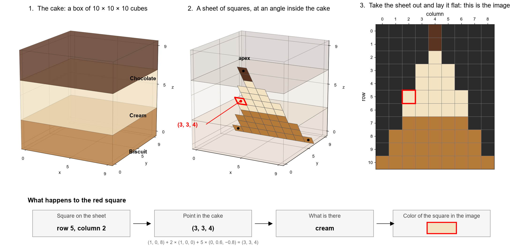
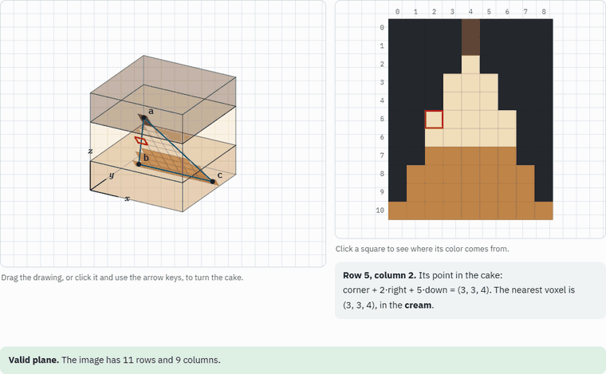

# Ex1: Plane projection of a 3D volume

[](https://github.com/aviya1221/ASG1_OOP/actions/workflows/tests.yml)

Introduction to Software Engineering, exercise 1.

## The problem

Given a 3D volume and a plane, compute the 2D image that the volume shows on the plane:
the cut that 3D Slicer shows along its three axes, but along any plane.

- **Volume:** an NRRD file of `sx × sy × sz` voxels, `1 <= sx, sy, sz <= 1023`, holding 8, 16 or 32-bit integers.
- **Plane:** an isosceles triangle `a, b, c` with apex `a`, or an isosceles trapezoid `a', b, a'', c` with legs `a' → b` and `a'' → c`.
- **Image:** each pixel takes the value of the nearest voxel, and 0 outside the volume.
- **Demo:** `python Ex0.py file.nrrd file.csv file.mp4` cuts the volume by every plane of the CSV file and writes one video frame per plane.
- **Speed:** on a 500³ volume, at least 30 planes per second, and 100 expected.



*A triangle placed at an angle inside a cake of three layers, and the image that comes out.*

[](https://aviya1221.github.io/ASG1_OOP/demo/)

*The [interactive demo](https://aviya1221.github.io/ASG1_OOP/demo/): turn the cake, move the points, and click a pixel to see which voxel it comes from.*

## Scope

| In scope | Out of scope |
|---|---|
| NRRD volumes of 8, 16 and 32-bit integers, raw or gzip | other input formats, and points in millimeters |
| triangles and trapezoids from a CSV file, in the lecturer's format | a graphical interface: 3D Slicer is used to look at the data |
| the image of any plane, also partly or fully outside the volume | interpolation between voxels, and volume rendering |
| an MP4 video with one frame per plane | other output formats |
| the speed target, the documents, the tests, a data set and an experiment | editing or segmenting the volume |

## Dependencies

Python 3.12 or newer, on Windows, macOS or Linux.

| Package | Used for |
|---|---|
| `numpy` | the volume and the projection |
| `pynrrd` | reading NRRD files |
| `imageio-ffmpeg` | writing the H.264 video; it brings its own FFmpeg |
| `pytest`, `pytest-cov` | the tests, from `requirements-dev.txt` |
| `scipy`, `matplotlib` | the tests, the experiment figures and the scripts that made the data set, from `requirements-dev.txt` |

```
python -m venv .venv
.venv\Scripts\activate                # macOS and Linux: source .venv/bin/activate
pip install -r requirements-dev.txt   # requirements.txt alone is enough to run the program
```

## Running

```
python Ex0.py file.nrrd file.csv file.mp4 [--fps N]
```

The CSV file has one plane per line: the number of points, 3 or 4, then `x, y, z` of each point, in voxel indices.
`python Ex0.py --help` shows the format with an example. A line that is not a valid plane does not stop the run:
it gives a warning and an error frame, and the summary at the end lists it.

```
pytest                                # the everyday tests, under a minute
pytest -m slow                        # the tests on the data set, and the demos
python tools/benchmark.py             # the speed on the 500³ volume
```

## A run

The lecturer's head scan, cut by the 280 planes of `DATA/head.csv` ([the video](experiment/videos/head.mp4)):

```
$ python Ex0.py DATA/MRHead_1.nrrd DATA/head.csv head.mp4
volume:      DATA/MRHead_1.nrrd, 256 x 256 x 130, int16
frames:      280 (0 errors, 0 warnings)
load:        0.14 s
projection:  1.38 s total, 4.9 ms per frame, 203 fps
video:       0.40 s
```

On the 500³ benchmark the projection runs at 317 planes per second, the median of 5 rounds, against 30 required and 100 expected.
The [experiment](experiment/README.md) has the runs on every volume with their videos, the edge cases, and the comparison with 3D Slicer.

## Documents and files

| Path | Contents |
|---|---|
| [docs/SRS.md](docs/SRS.md) | the requirements |
| [docs/ALGORITHM.md](docs/ALGORITHM.md) | the algorithm in detail, and the structure of the program |
| [docs/TESTING.md](docs/TESTING.md) | the testing strategy |
| [docs/DATA.md](docs/DATA.md) | the data set |
| [experiment/](experiment/README.md) | the experiment, its results and the output videos |
| [Ex0.py](Ex0.py), [plane_projection/](plane_projection/) | the demo, and the package with one module for each step |
| [tests/](tests/) | the tests, which run on every push on Windows, Ubuntu and macOS |
| [DATA/](DATA/) | the volumes and their planes files |
| [tools/](tools/), [dataSet_generation/](dataSet_generation/) | the benchmark and the experiment; the scripts that made the data set |
