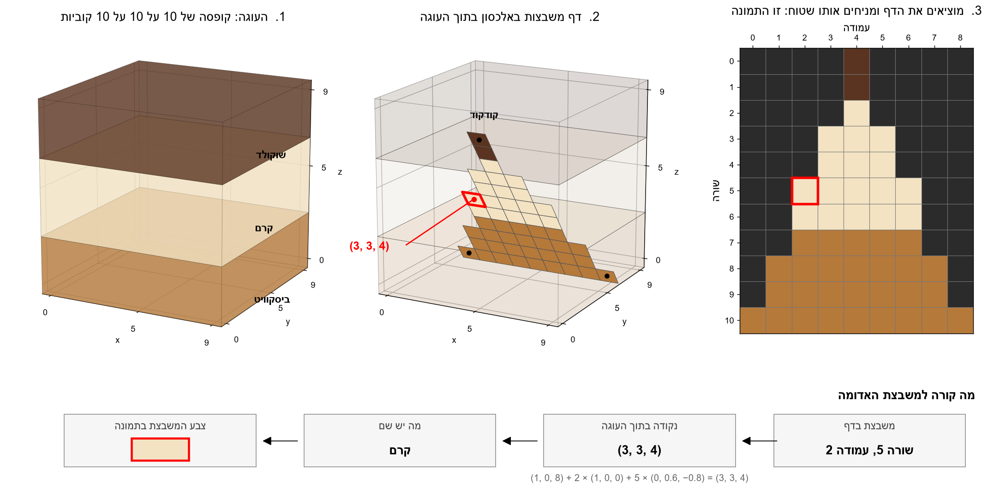

# Ex1: Plane projection of a 3D volume

Introduction to Software Engineering (OOP, OOD), exercise 1.

Given a 3D volume and a plane, produce the 2D image the volume shows on that plane:
the "cut" that 3D Slicer shows in its axial, coronal and sagittal views, but along any plane, not only the three axes.



*A 10 × 10 × 10 cake of three layers, a triangle placed at an angle inside it, and the image that comes out.
Each square of the output image takes the value of the voxel under its point in the volume.*

## The problem

**Input**

- A 3D matrix `M` of size `sx × sy × sz`, with `1 <= sx, sy, sz < 2^10` (at most 1023 on each axis).
  Each entry `M[x][y][z]` is an unsigned integer of 8, 16 or 32 bits.
  The volume is read from an [NRRD](https://teem.sourceforge.net/nrrd/format.html) file, the format of the 3D Slicer project.
- A plane `p`, given by 3 or 4 points in 3D:
  - **3 points** `a, b, c`: an isosceles triangle with apex `a`, so `dist(a,b) = dist(a,c)`.
  - **4 points**: an isosceles trapezoid, two sides of equal length on the same plane, `a' → b` and `a'' → c`.

**Output**

- A 2D matrix (image) `E` holding the values of `M` along the triangle (or trapezoid).
  Points of the plane that fall outside `M` get the value 0.

**The algorithm given in the assignment** (for the triangle; the trapezoid works the same way):

```
Dab = dist(a,b) = dist(a,c)
Dbc = dist(b,c)
v(a,b) = vector(a,b) / Dab          # unit step from a toward b
v(a,c) = vector(a,c) / Dab          # unit step from a toward c
E = new matrix of size Dab * Dbc

a1 = a, a2 = a
for y in 0 .. Dab-1:                # one output row per unit step down the sides
    a1 = a1 + v(a,b)
    a2 = a2 + v(a,c)
    d12 = dist(a1, a2)
    dp  = vector(a1, a2) / d12      # unit step along the row
    p   = a1
    for x1 in 0 .. d12:             # one output pixel per unit step along the row
        v = M[p]  (0 if p is outside M)
        x = Dbc/2 - d12/2 + x1      # center the row in E
        E[x][y] = v
        p = p + dp
return E
```

The assignment states that this problem is **not well defined for implementation**:
the pseudo-code leaves open questions that a detailed design has to answer (see [Open questions](#open-questions)).
The exact requirements are in the [Software Requirements Specification](docs/SRS.md),
the way the program meets them is in the [algorithm document](docs/ALGORITHM.md),
and the way it is checked is in the [testing strategy](docs/TESTING.md).

## The program

The demo is run as:

```
python Ex0.py file.nrrd file.csv file.mp4
```

| Argument | Meaning |
|---|---|
| `file.nrrd` | the 3D volume |
| `file.csv` | a list of planes, each given by the coordinates of 3 or 4 points |
| `file.mp4` | the output video: one frame per plane, in the order of the CSV |

The planes files of the demo, one for each volume of the main data set and one of edge cases, are in [demo/](demo/).
They are made by `tools/make_demo_planes.py` and described in the [testing strategy](docs/TESTING.md#61-demo-planes-files).

**Performance:** on a volume of 500³ bytes the projection must run at **30 frames per second at least**, and **100 is expected**.

## Scope

**In scope**

- Reading NRRD volumes of unsigned 8, 16 and 32-bit values, raw or gzip-compressed.
- Reading the planes from a CSV file, triangles (3 points) and trapezoids (4 points).
- Computing the projection image of each plane, correct and stable for any plane,
  including planes that lie partly or fully outside the volume.
- Writing the images as frames of an MP4 video.
- Meeting the speed target on a 500³ volume.
- Documents: this README, an SRS, a detailed description of the algorithm, the data set and a testing strategy.
- Tests, including tests of the demo, and an experiment with its results and output video.

**Out of scope**

- A graphical interface or an interactive viewer (3D Slicer is used to look at the data).
- Volume rendering: "projection" here means sampling the values on the plane, not summing or ray-casting through the volume.
- File formats other than NRRD for input and MP4 for output.
- Editing or segmenting the volume.

## Open questions

The assignment leaves these questions open. The [Software Requirements Specification](docs/SRS.md) answers each of them:

| # | Question | Answer |
|---|---|---|
| 1 | Are the points voxel indices, or physical positions from the NRRD header (as 3D Slicer shows them)? | voxel indices ([FR-13](docs/SRS.md#33-planes-file)) |
| 2 | `p` is almost never on a whole voxel: take the nearest one, or interpolate? | the nearest voxel ([FR-19](docs/SRS.md#34-projection-geometry)) |
| 3 | `Dab`, `Dbc`, `d12` and `x` are real numbers: how are they rounded? The loop skips the apex row: is that intended? | an exact image geometry with square pixels and the apex in row 0 ([3.4](docs/SRS.md#34-projection-geometry), [section 6](docs/SRS.md#6-deviations-from-the-assignment-text)) |
| 4 | `E` is a rectangle and the triangle covers about half of it: what do the other pixels get? | 0 ([FR-20](docs/SRS.md#34-projection-geometry)) |
| 5 | In which order are the 4 points of a trapezoid written? | `a', a'', b, c` ([FR-12](docs/SRS.md#33-planes-file)) |
| 6 | What if the triangle is not isosceles, the points are on one line, or two points are the same? | a black frame and a warning for bad planes, a warning for doubtful ones ([3.5](docs/SRS.md#35-input-validation)) |
| 7 | What does the CSV file look like? | one plane per line, 9 or 12 numbers, optional header and comments ([3.3](docs/SRS.md#33-planes-file)) |
| 8 | Each image has its own size, but a video needs one frame size; how are 16 and 32-bit values shown; at what rate? | images centered in a fixed frame, one gray-level map for the whole video, 30 fps by default ([3.6](docs/SRS.md#36-video-output)) |
| 9 | How do NRRD axes map to `M[x][y][z]`? `MRHead_1.nrrd` is signed. | `x` is the fastest axis on disk; signed types are accepted ([3.2](docs/SRS.md#32-volume-file)) |
| 10 | Does the speed target cover the projection alone, and for which planes? | the projection alone, on a fixed benchmark of 100 planes of 501 × 501 pixels ([4.1](docs/SRS.md#41-speed)) |

## Data

The data set is described in [DATA/README.md](DATA/README.md): the lecturer's MRI head scan,
simulated MRI scans of layered foods (including a 500³ file for the speed test), test volumes with known answers,
and a few real CT scans. Preview images are in [DATA/images/](DATA/images/).

The scripts that make the data are in [tools/](tools/). To set up:

```
python -m venv .venv
.venv\Scripts\activate
pip install -r requirements.txt
```

## Roadmap

- [x] Create a repository, define the problem and the scope (this README)
- [x] Software Requirements Specification ([docs/SRS.md](docs/SRS.md))
- [x] Detailed description of the main algorithm ([docs/ALGORITHM.md](docs/ALGORITHM.md))
- [x] Data set of NRRD files (first version, see [DATA/README.md](DATA/README.md))
- [x] Testing strategy, including the demo ([docs/TESTING.md](docs/TESTING.md))
- [ ] Implementation
- [ ] Demo: `python Ex0.py file.nrrd file.csv file.mp4`
- [ ] Experiment and a short description of its results, with the output video
