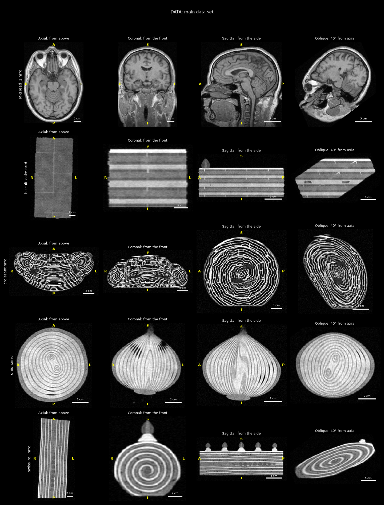

# Data set

The main data set is the lecturer's example, `MRHead_1.nrrd`, and four food scans made in its style.
Each food is a single object with many layers, so a plane through it at any angle shows a cut object with its layers:
the kind of image the projection algorithm has to produce.

| File | Object | Layers | Size (cm) | Voxel size (mm) | Value type |
|---|---|---|---|---|---|
| `MRHead_1.nrrd` | human head, T1-weighted MRI | skin, fat, skull, fluid, gray and white matter, ventricles | | 1 × 1 × 1.3 | `int16` |
| `onion.nrrd` | onion | 11 scales around two growing points | 9 wide, 10 tall with its neck and roots | 0.55 × 0.55 × 0.715 | `uint8` |
| `biscuit_cake.nrrd` | biscuit cake | 7 layers of biscuits, 6 of vanilla and chocolate cream, strawberries, chocolate on top | 24 long, 11 wide, 8 tall | 1 × 1 × 1.3 | `uint16` |
| `swiss_roll.nrrd` | Swiss roll | a spiral of sponge, jam and cream, 4 turns, with fruit inside and rosettes on top | 26 long, 9 wide, 7.5 tall | 1.1 × 1.1 × 1.43 | `uint32` |
| `croissant.nrrd` | chocolate croissant: the large file, for the speed test | a spiral of rolled dough around two chocolate sticks, each turn a honeycomb of thin sheets | 16 from tip to tip, 9 front to back, 6 tall | 0.37 × 0.37 × 0.37 | `uint8` |

The head and the three smaller foods hold 256 × 256 × 130 voxels. The croissant holds 500 × 500 × 500,
the size of the speed test in the assignment (a matrix of 500³ bytes at 100 frames per second).
All five are gzip-compressed NRRD.
The assignment allows a voxel to be an unsigned integer of 8, 16 or 32 bits, and the foods use all three sizes.
The head scan is a signed 16-bit file, but all its values are positive, so it reads like an unsigned one.
The food scans are simulated MRI scans, made by `tools/generate_foods.py`.

All the files are in the `DATA/` folder. Two more folders:
- `DATA/synthetic/` holds test volumes with an exact answer for every voxel: a cake, a tomato and a die.
- `DATA/real_scans/` holds four real CT scans from an earlier step: a teapot, a tooth, an engine and a carp.
  They are not single objects with many layers, so they are not part of the main set.

## What each part checks

| Data | Used for |
|---|---|
| small arrays built inside the tests | exact checks of the geometry, [FR-15 to FR-21](SRS.md#34-projection-geometry) |
| `synthetic/dice.nrrd` | values above 65535, and images known in advance: a square face with its pips, a hexagon through the center, a triangle cut off a corner |
| `synthetic/cake_3layers.nrrd` and `.seg.nrrd` | the label file gives the exact material of every pixel |
| `synthetic/tomato.nrrd` and `.seg.nrrd` | a tilted object that no axis lines up with |
| `MRHead_1.nrrd` | the lecturer's file: a signed type ([FR-6](SRS.md#32-volume-file)), and the main demo |
| `onion.nrrd`, `biscuit_cake.nrrd`, `swiss_roll.nrrd` | demo videos in all three value types of the assignment |
| `croissant.nrrd` | the speed benchmark, [NFR-1 to NFR-4](SRS.md#38-non-functional-requirements) |
| `real_scans/` | extra runs on real CT scans |

## Preview images

`DATA/images/` holds a picture of every volume: the cuts through its middle that 3D Slicer shows
in its three views, turned the same way and marked with the directions (R/L, A/P, S/I), and one oblique cut.
Each cut is zoomed in on the object and has a scale bar.
`images/overview.png` shows the main set, one row per file; `images/synthetic/` and `images/real_scans/` hold the others.



To make the images again, for example after changing a volume:

```
python tools/make_previews.py
```

## What each view shows

The cake, the roll and the croissant have clearly different lengths, widths and heights, and the onion has a clear top and bottom,
so each of the three views of 3D Slicer shows something else.
Repeating layers alone make a cut hard to read, so the foods also carry landmarks, distinct parts in known places,
the way the eyes and the ventricles mark a cut through the head: strawberries and two kinds of cream in the cake,
jam, fruit and rosettes of cream in the roll, and chocolate in the croissant.

| File | Axial: from above | Coronal: from the front | Sagittal: from the side |
|---|---|---|---|
| `onion.nrrd` | rings around the two growing points | rings closing at the neck and at the base | the same, with the two growing points side by side |
| `biscuit_cake.nrrd` | one layer of biscuits: a grid with cream in the joints | the 11 cm short side: stripes of biscuit, vanilla cream (bright) and chocolate cream (darker) | the 24 cm long side: the same stripes, the joints between biscuits, and a strawberry on top at the front |
| `swiss_roll.nrrd` | the long side, with chocolate along both edges and fruit along the middle of the back half | the spiral, with a rosette and a strawberry on top | the long side: five rosettes on top, fruit in the back half, the seam at the bottom |
| `croissant.nrrd` | the crescent, with the turns of dough as bands along it and the chocolate in the middle | a long, low arch in layers, with a spiral on each side where the plane crosses the curved body | the spiral of rolled dough, with the two dark chocolate sticks in it |

## What the food scans copy from the head scan

| Property | `MRHead_1.nrrd` | Food scans |
|---|---|---|
| Content | one head in the middle, on a black background | one food in the middle, on a black background |
| Layers | a line through the middle crosses 23 clear steps or lines | 13 (cake), 19 (roll), 29 (croissant), 35 (onion) |
| Grid | 256 × 256 × 130 voxels | the same; the croissant 500 × 500 × 500 |
| Value type | `int16`, values 0 to 279 | all three sizes the assignment allows: `uint8` (onion, values up to 232; croissant, up to 255), `uint16` (cake, up to 3986), `uint32` (roll, up to 186330) |
| Voxel shape | 1 × 1 × 1.3 mm: slices 1.3 times farther apart than pixels | s × s × 1.3s, with s = 0.55, 1 or 1.1 mm; the croissant has cubic voxels of 0.37 mm |
| Orientation | sagittal slices: i runs front to back, j top to bottom, k left to right | the same |
| Space directions | (0,1,0) (0,0,−1) (−1.3,0,0) | the same, times s |
| Fill | about 90% of each axis | 87 to 97% of the longest side; the shorter sides fill less |
| Intensity | brain about 70, fat about 140 | the head scan's scale times 1.8 (onion, croissant), 20 (cake) or 1000 (roll); on the head scan's scale, strawberries 55, biscuits, sponge and onion about 60 to 100, dough 105, cream 82 to 132, chocolate ganache 150 and solid chocolate 18 |
| Background | 0 to about 8; 40% of it is 0, mean about 1.8 | the same, times the food's multiplier |
| MRI look | soft edges with faint ringing, slow shading, noise σ ≈ 4.5 | the same, simulated |

The voxel size changes from food to food, so that each food fills the field of view the way the head does.
A real scanner does the same: a smaller object is scanned with smaller voxels.
The values are multiplied so that each file uses its type: the onion stretches over the 8-bit range,
the cake's values reach about 4000, like the 12-bit values of an MRI scanner, which do not fit in 8 bits,
and the roll's values reach about 186,000, which do not fit in 16 bits.
A program that reads a type wrongly therefore gives a visibly wrong image. In 3D Slicer they all look alike,
because Slicer sets the brightness from each file's range.

The head and the three smaller foods share the grid, so a plane given in voxel indices fits all four of them,
and one CSV of planes can be run on each. The croissant's grid is larger, so it needs planes of its own.

## `onion.nrrd`

A yellow onion, about 90 mm wide; with its neck and roots it is about 103 mm tall. It leans 7° and its outline bulges a little.
Stored as `uint8`, with the values multiplied by 1.8.

- **Scales:** 11 fleshy scales, from 4.3 to 5 mm thick near the outside down to 2 mm in the middle.
  Every scale runs from the base plate at the bottom up into the neck, so a vertical cut shows rings that close at the top and at the bottom,
  and a horizontal cut shows closed rings.
- **Middle:** two growing points side by side, so the innermost rings split in two. The inner rings also sit a little off-center.
- **Between scales:** a thin dark line, with small air gaps here and there, more of them toward the neck.
- **Inside a scale:** a faint row of vascular bundles along its middle.
- **Bottom and top:** the base plate with a tuft of dry, trimmed roots under it, and the dry neck, cut off at a slant.
- **Outside:** the outermost scale is drying out, so it is darker. The papery skin gives no MRI signal.

## `biscuit_cake.nrrd`

A biscuit cake built in a loaf pan: 24 cm long (front to back), 11 cm wide and 8 cm tall, with the same voxels as the head scan.
Stored as `uint16`, with the values multiplied by 20.
It stands level on a tray, which gives no MRI signal, so its layers lie along the voxel rows. It is turned 1.5° and sits 10 mm left of the middle,
so the middle slices do not fall into a joint between biscuits.

- **Biscuits:** 7 layers of petit-beurre biscuits, 54 × 58 mm with a scalloped edge and a grid of pricked holes, 5.5 mm thick after soaking in milk.
  They are wet near their surfaces and drier, so darker, in their middle. Each layer has two biscuits across and five pieces along;
  the layers alternate between two patterns, with broken pieces at the ends, so the joints do not line up.
- **Cream:** 5.9 mm between the layers and in the 2 mm joints between biscuits, bulging out a little at the sides.
  From the bottom up: vanilla, chocolate, vanilla with strawberries, chocolate, vanilla, chocolate. Vanilla cream is brighter, so the layers can be told apart.
- **Strawberries:** the middle layer of cream is 9 mm thick and holds eight slices of strawberry, in two rows of four.
  Three whole strawberries stand on top at the front end, so the front is easy to find.
- **Chocolate:** 5 mm of ganache on top, the brightest part, as it is rich in fat.

Apart from the thicker middle layer, the layers repeat every 11.4 mm, which gives a check of the geometry: a plane tilted by an angle α
from the horizontal shows the stripes 11.4 / sin α mm apart, for example 11.4 mm in a vertical plane and 22.8 mm at α = 30°.
The middle of the field of view falls in the middle of the fourth biscuit layer, so the Axial view opens on a layer of biscuits.

## `swiss_roll.nrrd`

A Swiss roll lying along the front-to-back axis: 26 cm long, 9 cm wide and 7.5 cm tall. It is turned 2.5°.
Stored as `uint32`, with the values multiplied by 1000.

- **Spiral:** a sheet of sponge spread with jam and whipped cream and rolled up, in 4 turns of 5.5 mm sponge, 1.2 mm jam and 2.7 mm cream.
  The jam is dark and the cream bright, so each turn shows a dark and a bright line, and the way the spiral turns can be seen.
  The roll has settled, so it is wider than tall, and the spiral is not quite even along the roll.
- **Sponge:** with gas bubbles and darker baked surfaces.
- **Fruit:** a row of strawberry pieces in the middle of the spiral, in the back half of the roll only.
- **Seam:** the roll lies on the end of the sheet, which thins out there, so a little cream shows at the bottom.
- **Chocolate:** 2.5 mm of ganache over the top and the sides. The two ends were cut off after it was poured, so they show the bare spiral.
- **Rosettes:** five rosettes of whipped cream along the top, 52 mm apart, each with a strawberry on it.

## `croissant.nrrd`

The large file, for the speed test: 500 × 500 × 500 voxels of `uint8`, one byte each as in the assignment, with cubic voxels of 0.37 mm.
The values are multiplied by 1.8. The croissant is about 16 cm from tip to tip, 9 cm from front to back and 6 cm tall,
with its tips toward the front. The file is 63 MB.

- **Shape:** a triangle of laminated dough rolled up from its base and curved into a crescent. The middle holds the most turns, about four;
  toward the tips the outer turns end one after the other, which leaves shallow grooves across the top.
- **Inside:** each turn of dough is a stack of thin sheets with air between them, joined by thin walls, so the air forms long cells:
  the honeycomb that makes a croissant flaky. Where two turns touch, the dough is dense. These details are a fraction of a millimeter thick,
  which is why this croissant needs fine voxels.
- **Crust:** thin, dry and darker. The end of the dough lies on top of the middle.
- **Chocolate:** two sticks of chocolate, 10 × 4 mm and 8 cm long, rolled into the middle third. Solid chocolate gives almost no MRI signal,
  so they are two dark bars inside the bright dough.
- **Almonds:** flaked almonds on top, rich in oil, so bright.
- **Tray:** the croissant sits on a tray, which gives no MRI signal, so its bottom is flat.

GitHub accepts a file of this size but warns about files over 50 MB. Instead of sharing the file, it can be made again with
`python tools/generate_foods.py --only croissant`, which takes about five minutes and about 1.5 GB of memory.

## Making the food scans again

```
python tools/generate_foods.py                    # all four foods into DATA/
python tools/generate_foods.py --only onion       # just one: onion, biscuit_cake, swiss_roll or croissant
```

Each food is built from a model of the real object, then imaged the way the head was scanned (`tools/head_style.py`):
blurred by the limited resolution of MRI, shaded, given noise, and stored in the food's value type.
Surfaces are drawn as the fraction of each voxel that they cover, so slanted surfaces come out smooth, not as staircases.
The script reads each file back and checks the data, the header, the value type and range, the dark background,
that the food does not touch the edge of the field of view, and that a line through its middle crosses at least 10 layer boundaries.
The croissant is built a slab at a time, and its last checks run at half resolution, to keep the memory use small.
Random choices use fixed seeds, so the data is identical on every run.

## Conventions of the main set

- The volumes are indexed `vol[i, j, k]`, which is `M[x][y][z]` in the assignment. On disk i is the fastest axis, as the NRRD standard requires.
- As in the head scan, i runs from the front to the back, j from the top to the bottom and k from the left to the right of the object.
- In 3D Slicer the foods stand upright, like the head: the Axial view cuts horizontally, the Coronal view shows the object from the front,
  and the Sagittal view from the side.
- In the food scans, the middle of the field of view is at (0, 0, 0) mm. The head scan's origin is elsewhere: (86.6, −133.9, 116.8) mm.

---

# Test volumes: `DATA/synthetic/`

Generated volumes with known geometry. Each scan comes with an exact answer:
a `.seg.nrrd` segmentation for the simulated scans, and exact values for the die.
They are meant for automated tests of the algorithm, where the expected image must be known.

| File | Source | Voxel type | Size (x × y × z) | Spacing (mm) | Content |
|---|---|---|---|---|---|
| `synthetic/cake_3layers.nrrd` | simulated MRI | `uint8` | 256 × 180 × 96 | 1 × 1 × 1.3 | rectangular three-layer cake, scanned in the style of MRHead |
| `synthetic/cake_3layers.seg.nrrd` | ground truth | `uint8` | 256 × 180 × 96 | 1 × 1 × 1.3 | material of every voxel of the cake (14 segments) |
| `synthetic/tomato.nrrd` | simulated MRI | `uint16` | 204 × 196 × 184 | 0.4 × 0.4 × 0.4 | T2-weighted scan of a tomato |
| `synthetic/tomato.seg.nrrd` | ground truth | `uint8` | 204 × 196 × 184 | 0.4 × 0.4 × 0.4 | tissue of every voxel of the tomato (11 segments) |
| `synthetic/dice.nrrd` | synthetic geometry | `uint32` | 200 × 180 × 160 | 1 × 1 × 1 | game die with pips; values above 65535 |

```
python tools/generate_datasets.py                  # all test volumes into DATA/synthetic/
python tools/generate_datasets.py --only cake      # just one: cake, tomato or dice
```

The script reads each file back after writing it and checks the data, the header, the set of label values and a list of known voxels.
For the simulated scans it also checks that the main materials have the expected brightness order.
Random choices use fixed seeds, so the voxel data is identical on every run; only the creation-time comment that pynrrd puts in the header changes.
The label values are defined as `IntEnum`s: `Material` in `tools/cake.py`, `Tissue` in `tools/tomato.py`, `Dice` in `tools/generate_datasets.py`.
For a test, project the `.seg.nrrd` file with the same plane as the scan: every pixel of that image has an exact material label.

These files use simpler conventions than the main set:
- Volumes are indexed `vol[x, y, z]`, the same as `M[x][y][z]` in the assignment. On disk x is the fastest axis.
- Header: `space: left-posterior-superior`, `space origin: (0,0,0)`, `encoding: gzip`, and diagonal `space directions` holding the voxel size.
- Voxel `(x, y, z)` is sampled at its center. Ranges written `[a, b)` include a and exclude b.
- In 3D Slicer the IJK index equals `(x, y, z)`. With voxel size (sx, sy, sz), RAS = `(-sx·x, -sy·y, sz·z)`, so the IJK-to-RAS matrix is `diag(-sx, -sy, sz)`.
- Slicer's Axial view shows x to the right and y downward. The Coronal view shows x to the right and z upward.

## `synthetic/cake_3layers.nrrd`

A simulated T1-weighted MRI of a rectangular three-layer cake, made to look like `MRHead_1.nrrd`:
the same voxel size (1 × 1 × 1.3 mm), intensity scale, noise level (σ = 4.5) and black background. Built by `tools/cake.py`.
The cake (170 × 110 mm, about 87 mm tall) sits square to the axes, so the axial view shows the top, the coronal view the long side and the sagittal view the short side.

- From the bottom, on a platter and a cake board: chocolate sponge (z 16 to 38 mm), ganache (38 to 44), vanilla sponge (44 to 66),
  whipped cream with lengthwise strawberry slices (66 to 74), and vanilla sponge with chocolate chips (74 to 96). The layers are trimmed flat.
- Buttercream frosting, 4 mm on the sides and flat on top at z = 100.5, under a 2 mm ganache glaze; five halved strawberries along the back.
- A chocolate truffle with a hazelnut, 32 mm across, centered at (128, 90, 55) mm.
- The corner piece x ≥ 168, y ≤ 80 mm has been cut out.

| Material | Label | Signal | Notes |
|---|---|---|---|
| Background, platter | 0, 1 | 0 | porcelain gives no MRI signal |
| Cake board | 2 | 3 | |
| Chocolate, vanilla, chip sponge | 3, 5, 7 | 66, 74, 72 | porous, with gas holes; darker baked surfaces |
| Ganache, glaze | 4, 11 | 122 | |
| Whipped cream | 6 | 105 | |
| Chocolate chip, truffle shell | 8, 12 | 16, 18 | solid chocolate: almost no signal |
| Strawberry | 9 | 44 | mostly water |
| Buttercream | 10 | 150 | mostly fat, like MRHead's scalp fat |
| Truffle filling, hazelnut | 13, 14 | 118, 155 | |

## `synthetic/tomato.nrrd`

A simulated T2-weighted MRI of a tomato, 64 mm wide and 52 mm tall, with 0.4 mm voxels. Built by `tools/tomato.py`.
It has a skin, a 6.2 mm pericarp with vascular bundles, five gel-filled locules separated by septa, a columella with placenta lobes,
210 seeds, a stem with six sepals and a small air pocket. The fruit is tilted 8° and off-center, so no axis is aligned with it.
The gel is the brightest tissue and the seeds are dark; the background is Rician noise (mean ≈ 48).

| Tissue | Label | Signal | Tissue | Label | Signal |
|---|---|---|---|---|---|
| Background | 0 | 0 | Gel | 6 | 1900 |
| Skin | 1 | 600 | Seed | 7 | 300 |
| Pericarp | 2 | 1250 | Vascular bundle | 8 | 750 |
| Septum | 3 | 1150 | Stem | 9 | 600 |
| Columella | 4 | 1100 | Sepal | 10 | 750 |
| Placenta | 5 | 1450 | Air pocket | 11 | 0 |

## `synthetic/dice.nrrd`

`uint32`, 200 × 180 × 160, two exact values: the body (100000), the cube x in [40, 160), y in [30, 150), z in [20, 140),
and the pips (200000), spheres of radius 9 centered on the face planes. Opposite faces add up to 7:
+z has 1 pip, −z 6, +x 2, −x 5, +y 3 and −y 4.

Expected images:
- **Axial z = 139:** a 120 × 120 square with one pip in the middle; **axial z = 20:** six pips; **coronal y = 30:** four pips.
- **Plane through the center, perpendicular to the main diagonal (x + y + z = 268.5):** a regular hexagon with side 60√2 ≈ 84.9.
- **Plane x + y + z = 408.5:** cuts off the corner (159, 149, 139) as an equilateral triangle with side 40√2 ≈ 56.6.

---

# Other real scans: `DATA/real_scans/`

Four real CT scans from the Open Scientific Visualization Datasets collection, https://klacansky.com/open-scivis-datasets/,
converted to NRRD with the conventions of `synthetic/` above. They are not single objects with many layers, so they are not part of the main set.

| File | Object | Voxel type | Size (x × y × z) | Spacing (mm) | Credit |
|---|---|---|---|---|---|
| `boston_teapot.nrrd` | ceramic teapot with a small lobster inside | `uint8` | 256 × 178 × 256 | 1 × 1 × 1 | volvis.org and Terarecon Inc, MERL, Brigham and Women's Hospital |
| `tooth.nrrd` | tooth (micro-CT) | `uint8` | 103 × 94 × 161 | 1 × 1 × 1 | GE Aircraft Engines, Evendale, Ohio, USA |
| `engine.nrrd` | two cylinders of an engine block | `uint8` | 256 × 256 × 128 | 1 × 1 × 1 | volvis.org and General Electric |
| `carp.nrrd` | carp fish | `uint16` | 256 × 256 × 512 | 0.78125 × 0.390625 × 1 | Michael Scheuring, Computer Graphics Group, University of Erlangen, Germany |

Keep the credits with the data. To download them again:

```
python tools/fetch_real_scans.py
```

The script downloads each raw file over plain HTTP (the collection's HTTPS port does not answer), checks it against the collection's SHA-512 checksum,
and converts it. The teapot and the carp are turned so that they stand upright; both turns are rotations, so nothing is mirrored.

---

## Viewing in 3D Slicer

Drag a `.nrrd` file into the Slicer window, or use File → Add Data.
For the test volumes, drag a scan together with its `.seg.nrrd` file to see each material as a colored, named overlay.

| Tool | Use |
|---|---|
| Data Probe (bottom left) | shows the IJK index, the value and the segment under the mouse |
| Reformat module | slices the volume along any oblique plane, which is what our algorithm will do |
| Volume Rendering module | 3D view of the volume |
| Volumes module → Window/Level | brightness and contrast |
