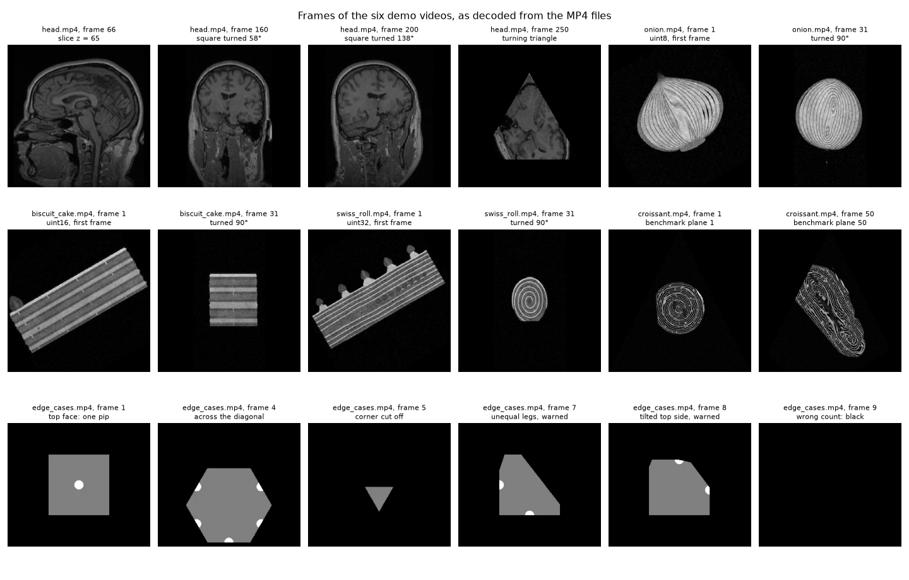
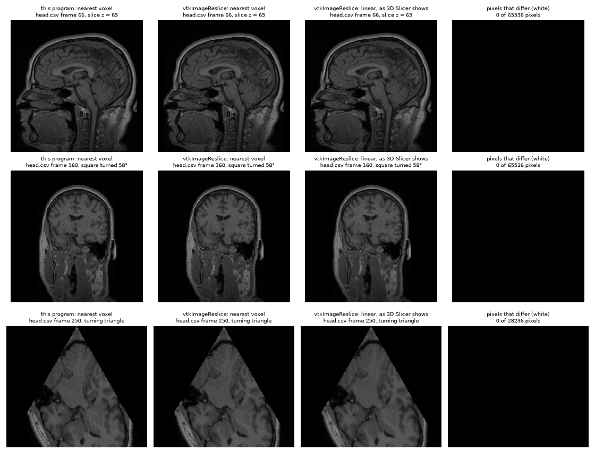

# Experiment

**Ex1: Plane projection of a 3D volume**
2026-10-22

The demo program, `Ex0.py`, was run on the six demo planes files, its images were compared pixel by pixel with the reslicing filter of
3D Slicer, and its speed was measured on the benchmark of the [requirements](../docs/SRS.md#41-speed).
All the results in this folder are made again by one command:

```
python tools/run_experiment.py            # or --only demos, --only speed, --only slicer
```

| Folder | Contents |
|---|---|
| [videos/](videos/) | the six output videos |
| [results/](results/) | the printed output of the runs, and the measurements |
| [images/](images/) | chosen frames, and the comparison with 3D Slicer |

**Machine:** a laptop with an Intel Core i7-10610U (4 cores, 8 threads), 16 GB of memory, Windows 11, Python 3.13.15, NumPy 2.5.4.
The speed measurements of [section 3](#3-speed) ran on the charger, while Windows reported the processor clock at 1.8 GHz of the 2.3 GHz it reports as the maximum.

---

## 1. The demo videos

```
python Ex0.py DATA/MRHead_1.nrrd demo/head.csv experiment/videos/head.mp4
```

and the same for the other five files. All six runs ended with exit code 0 ([results/demo_runs.txt](results/demo_runs.txt)).

| Video | Volume | Value type | Frames | Frame size | What it shows |
|---|---|---|---|---|---|
| [head.mp4](videos/head.mp4) | `MRHead_1.nrrd`, the lecturer's MRI | `int16` | 280 | 256 × 256 | the head slice by slice from side to side, then a square turning around the vertical axis, then a turning triangle |
| [onion.mp4](videos/onion.mp4) | `onion.nrrd` | `uint8` | 120 | 256 × 256 | a square turning around a tilted axis through the onion |
| [biscuit_cake.mp4](videos/biscuit_cake.mp4) | `biscuit_cake.nrrd` | `uint16` | 120 | 256 × 256 | the same planes through the cake |
| [swiss_roll.mp4](videos/swiss_roll.mp4) | `swiss_roll.nrrd` | `uint32` | 120 | 256 × 256 | the same planes through the roll |
| [croissant.mp4](videos/croissant.mp4) | `croissant.nrrd`, 500 × 500 × 500 | `uint8` | 100 | 502 × 502 | the 100 planes of the speed benchmark |
| [edge_cases.mp4](videos/edge_cases.mp4) | `synthetic/dice.nrrd` | `uint32` | 16 | 282 × 244 | known images of a die, and one line for each kind of bad or doubtful plane |



What the frames show:

- **The die** gives the images that are known in advance: the top face with one pip, a regular hexagon for the plane across the main diagonal,
  and a triangle for the plane that cuts off a corner.
- **The edge cases** give exactly the expected warnings, one per line, each naming its line and frame
  (frames 7 and 8 are drawn with a warning, frames 9 to 16 are black), and frame 6, a plane outside the volume, is black without a warning.
  The full list is in the [testing strategy](../docs/TESTING.md#61-demo-planes-files).
- **The three foods** show their layers in all three value types of the assignment.
- **The head** looks shorter along `z` than in 3D Slicer. Its voxels are 1.3 times longer along `z`, and the program draws one pixel per voxel unit
  ([FR-13, FR-17](../docs/SRS.md#34-projection-geometry)), while 3D Slicer draws millimeters. This is expected.
- Parts of a plane that leave the volume are black, as in the turned squares of the head.

The frames above were checked one by one. The motion of the videos is checked by watching them.

---

## 2. Comparison with 3D Slicer

[tools/slicer_reslice.py](../tools/slicer_reslice.py) runs inside 3D Slicer 5.12.4 and samples the same planes with `vtkImageReslice` (VTK 9.6.2),
the filter 3D Slicer draws its slice views with. It gets only the position of each plane and its pixel grid, and shares no code with the program.
Pixels inside the shapes were compared, with `vtkImageReslice` set to the nearest voxel as the program is ([results/slicer_comparison.txt](results/slicer_comparison.txt)).

| Volume and planes | Planes | Pixels compared | Identical | Different |
|---|---|---|---|---|
| `MRHead_1.nrrd`, `head.csv` | 280 | 15,255,640 | 99.9991% | 131 |
| `swiss_roll.nrrd`, `swiss_roll.csv` | 120 | 7,864,320 | 99.9997% | 26 |
| `synthetic/dice.nrrd`, `edge_cases.csv` (valid planes) | 8 | 185,374 | 100% | 0 |
| **all** | **408** | **23,305,334** | **99.9993%** | **157** |

All 157 differing pixels lie halfway between two voxels on some axis, within 0.00001 of a voxel. There the nearest voxel is a tie:
the program rounds exactly by `floor(p + 0.5)` ([FR-19](../docs/SRS.md#34-projection-geometry)), while VTK rounds with a small tolerance, so the two pick different neighbors.
Away from these ties the two images are the same.



The third column shows linear interpolation, as 3D Slicer shows a slice by default. It is smoother; the program takes the nearest voxel, as the requirements say.

---

## 3. Speed

The benchmark of [NFR-4](../docs/SRS.md#41-speed) is the 100 triangles of `demo/croissant.csv` through the 500 × 500 × 500 croissant, each an image of 501 × 501 pixels.
The time of a plane is that of `plane_setup` and `Projector.project` together ([NFR-3](../docs/SRS.md#41-speed)).
Each configuration ran 5 rounds, every round running all configurations in turn, so that changes of the processor clock affect them alike
([results/speed.txt](results/speed.txt)). The laptop was on the charger.

**Threads** (`uint8`, 501 × 501):

| Threads | Median fps | ms per frame | Rounds |
|---|---|---|---|
| 1 | 86 | 11.6 | 82 to 96 |
| 2 | 188 | 5.3 | 148 to 205 |
| **4** | **317** | **3.2** | 265 to 324 |
| 8 | 215 | 4.7 | 205 to 217 |

**Value type** (4 threads, 501 × 501):

| Type | Median fps | ms per frame | Rounds |
|---|---|---|---|
| `uint8` | 316 | 3.2 | 277 to 319 |
| `uint16` | 306 | 3.3 | 294 to 307 |
| `uint32` | 278 | 3.6 | 266 to 293 |

**Image size** (`uint8`, 4 threads, triangles of the same directions with another base and height):

| Image | Median fps | ms per frame | ns per pixel of the triangle |
|---|---|---|---|
| 101 × 101 | 634 | 1.6 | 310 |
| 201 × 201 | 523 | 1.9 | 95 |
| 301 × 301 | 470 | 2.1 | 47 |
| 401 × 401 | 375 | 2.7 | 33 |
| 501 × 501 | 308 | 3.3 | 26 |
| 701 × 701 | 173 | 5.8 | 24 |

**Results**

- **The target of 100 fps (NFR-2) is met: 317 fps**, about 3 times the target and 10 times the minimum of 30 fps (NFR-1).
  An earlier run of `tools/benchmark.py` the same day gave 304 fps, in agreement.
- **Even one thread meets the minimum**, at 86 fps, and every round of every configuration was above 80 fps.
- **4 threads are the fastest**, 3.7 times one thread. With 8, two threads share each of the 4 cores and the run is slower, as the prototype showed
  ([ALGORITHM 6](../docs/ALGORITHM.md#6-speed)).
- **Wider values are a little slower**, since each pixel reads more memory: 278 fps for `uint32`.
- **The time grows with the number of pixels**: for images from 401 pixels up, about 24 to 33 ns per pixel of the triangle.
  Small images are held back by a fixed cost of about 1.5 ms per plane, for the setup and the work of starting the threads.

**On battery** the same measurement was much slower and less steady ([results/speed_on_battery.txt](results/speed_on_battery.txt)):
90 fps median with 4 threads, rounds from 56 to 119, while Windows reported the processor at 1.5 to 1.8 GHz.
That is still 3 times the minimum, but below the target: the speed of the program depends on the power of the laptop.

In the full demo runs, reading the croissant took 2.4 s and writing its video 0.7 s ([results/demo_runs.txt](results/demo_runs.txt)); the requirements
set no target for these.

---

## 4. Conclusions

- The program does what the requirements define: every demo run gave the expected number and size of frames and the expected warnings,
  and its images agree with the reslicing filter of 3D Slicer on every pixel except exact ties between two voxels.
- It meets the speed target: 317 fps on the benchmark, about 3 times the target of 100 and 10 times the minimum of 30.
  On battery the laptop slows down, and the median fell to 90 fps, still 3 times the minimum.
- **Limitations.** Speed was measured on one laptop. The nearest voxel makes oblique cuts look blocky next to 3D Slicer's smooth view, and pixels in voxel units
  make volumes with long voxels look shorter. Interpolation between voxels and coordinates in millimeters would be natural next steps.
